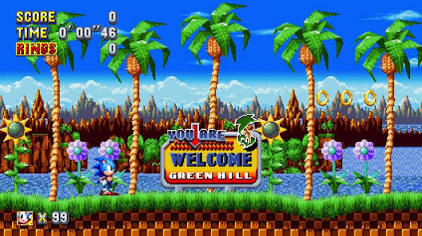

*Sonic the Hedgehog* (1991) on the SEGA Genesis/Mega Drive consists of **6 primary Zones**, a **Final Zone**, and rotating **Special Stages**.

Each main Zone is split into **3 Acts** (Acts 1 and 2 focus on platforming, while Act 3 ends with a boss fight against Dr. Robotnik).

---

**1. Green Hill Zone**

* **Theme:** Lush tropical paradise with loops, crumbling cliffs, and checkboard terrain.
* **Boss:** Dr. Robotnik with a swinging wrecking ball.

**2. Marble Zone**

* **Theme:** Ancient underground ruins with lava streams, moving platforms, and spikes.
* **Boss:** Dr. Robotnik dropping fireballs onto moving platforms over lava.

**3. Spring Yard Zone**

* **Theme:** Urban pinball-style environment filled with springs, bumpers, and slow-moving blocks.
* **Boss:** Dr. Robotnik using a spike attachment to destroy the floor blocks beneath Sonic.

**4. Labyrinth Zone**

* **Theme:** Submerged temple where Sonic must manage his air supply using underwater air bubbles.
* **Boss:** A vertical escape climb through rising water while dodging obstacles (no direct hit required).

**5. Star Light Zone**

* **Theme:** Nighttime highway set against a starry cityscape, featuring high-speed loops and see-saws.
* **Boss:** Dr. Robotnik dropping spiked balls onto see-saws to launch back at him.

**6. Scrap Brain Zone**

* **Theme:** Dr. Robotnik's heavily fortified industrial base filled with traps, saws, electric hazards, and a labyrinthine Act 3.
* **Boss:** No direct boss fight; leads straight into a trap door to the final area.

**7. Final Zone**

* **Theme:** A single-act boss arena with no rings available.
* **Boss:** Dr. Robotnik inside a crushing machine with four hydraulic pistons and energy beams.

---

**Special Stages**

* **Access:** Finish Act 1 or Act 2 of any zone with **50 or more Rings** and jump into the Giant Ring at the goal post.
* **Goal:** Navigate a rotating maze to collect a **Chaos Emerald** before hitting a "GOAL" block. There are **6 Chaos Emeralds** total to collect.